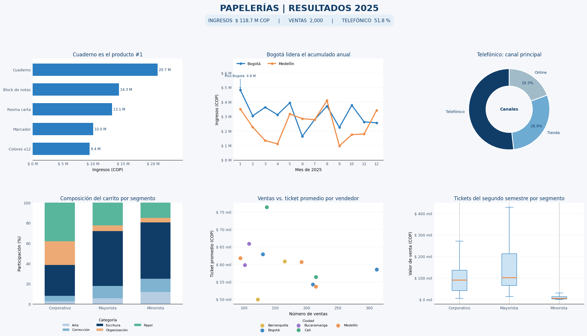

# Dashboard de ventas de papelerías | 2025

Proyecto de referencia para el taller «De los datos a un dashboard publicado» de Programación (ADMI 1301).



## Abrir el trabajo

**[Ver el notebook con los seis gráficos y el dashboard final](Taller_Dashboard_Papelerias_GitHub.ipynb)**

El notebook está ejecutado y conserva las salidas de los gráficos, de modo que GitHub puede mostrarlas sin ejecutar Python.

## Incluye

| Parte | Contenido |
| --- | --- |
| A | Seis ejercicios: top de productos, ventas mensuales por ciudad, canales, categorías por segmento, vendedores y tickets del segundo semestre. Incluye tablas y verificaciones. |
| B | Dashboard base de seis paneles en una cuadrícula de 2 filas × 3 columnas. |
| C | `prompt_v1`, `prompt_v2`, una primera versión visual y una segunda versión con mejoras concretas. |
| D | Dashboard final, tres hallazgos numéricos y una reflexión en tres líneas sobre la iteración visual. |

## Tres hallazgos verificados

1. El **Cuaderno** es el producto con mayores ingresos: **$20.712.345 COP**.
2. El canal **Telefónico** representa **51,8 %** de los ingresos.
3. **Bogotá** representa **31,9 %** de los ingresos de la cadena.

Los cálculos se obtienen de `ventas_papelerias_2025.csv` (2.000 registros).

## Publicar en GitHub (sin necesidad de programar en GitHub)

1. En https://github.com/new crea un repositorio llamado `mi-dashboard-ventas`, con visibilidad **Public**.
2. En la página del repositorio, pulsa **Add file → Upload files**.
3. Sube los cinco archivos de este paquete, **descomprimidos**, a la raíz del repositorio; no subas únicamente el ZIP.
4. Pulsa **Commit changes**.
5. Haz clic en `Taller_Dashboard_Papelerias_GitHub.ipynb`: verás el análisis y las figuras. Copia la dirección del navegador y comprueba que abre en incógnito.

Para modificar el notebook desde GitHub puedes usar **Code → Codespaces → Create codespace on main**, seleccionar el kernel de Python y ejecutar todas las celdas. Las dependencias están en `requirements.txt`.

```bash
python -m pip install -r requirements.txt
```

## Archivos

- `Taller_Dashboard_Papelerias_GitHub.ipynb`: solución de referencia con resultados y figuras guardados.
- `ventas_papelerias_2025.csv`: datos suministrados.
- `dashboard_previsualizacion.png`: imagen de la versión final.
- `README.md`: descripción e instrucciones.
- `requirements.txt`: librerías de Python.

## Nota académica

La guía indica que la persona estudiante debe escribir las partes A y B, y usar IA en la parte C. Este material es una **solución de referencia para revisar, comprender y adaptar**; verifica las normas del curso antes de presentar una entrega como trabajo propio. No se proporcionó el notebook en blanco mencionado en la guía, por lo que el notebook incluido es independiente.
